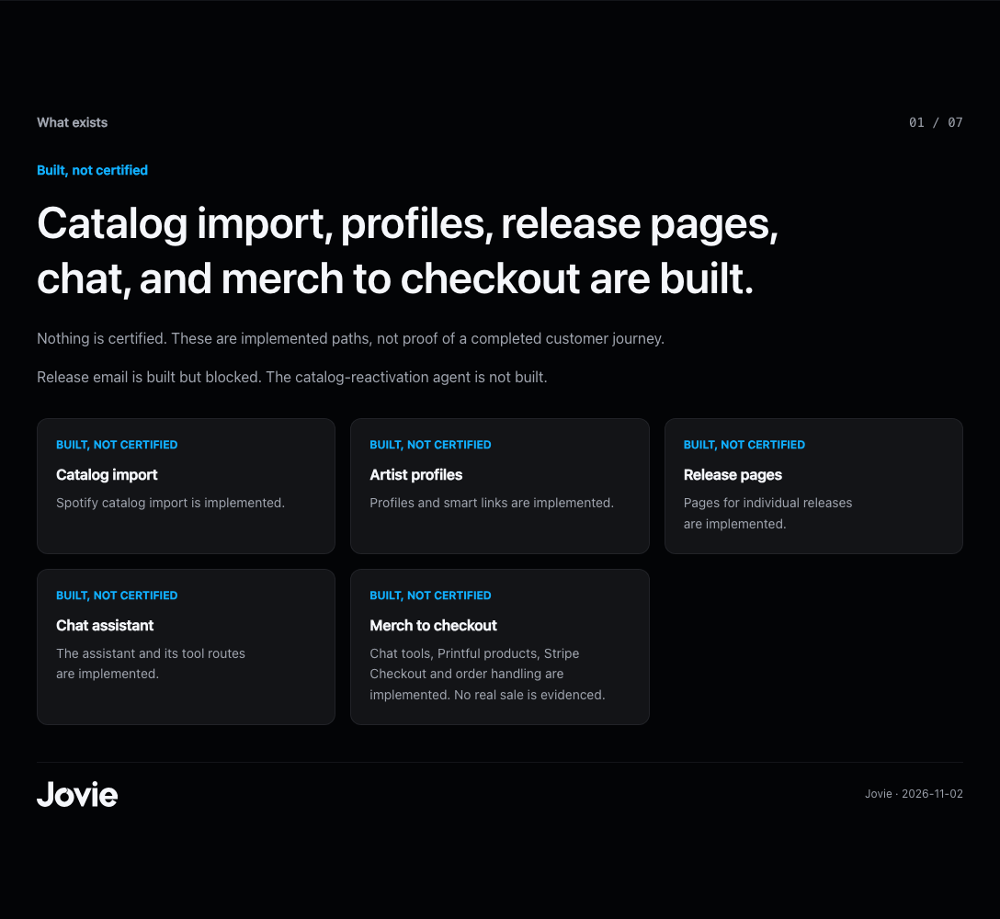
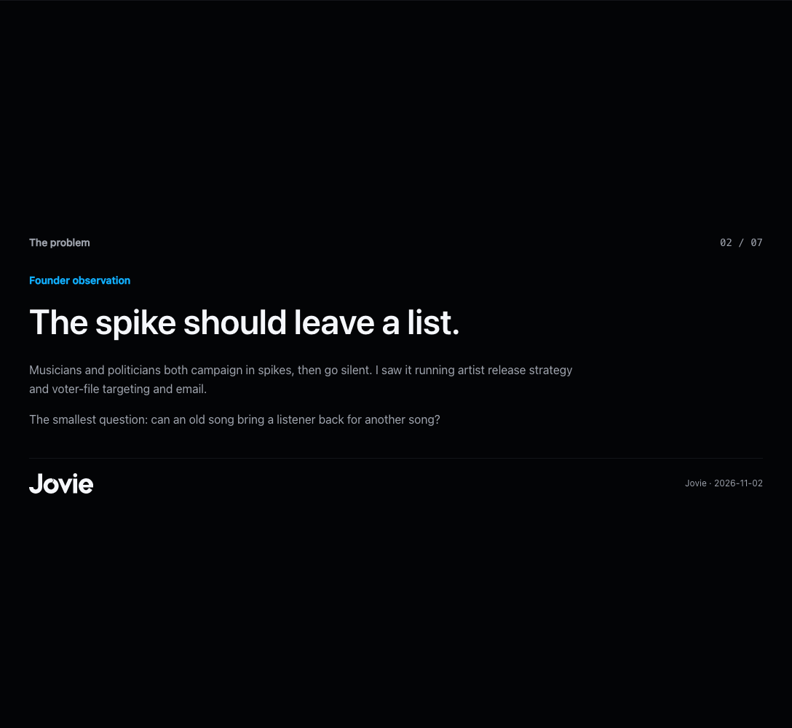
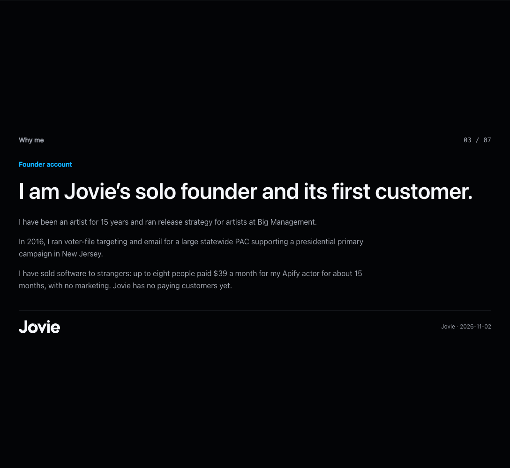
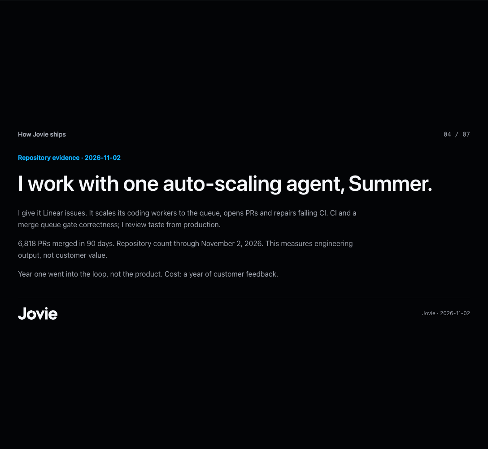
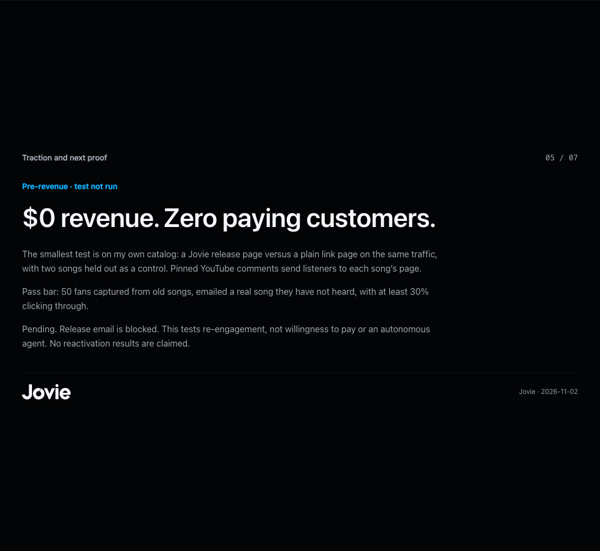
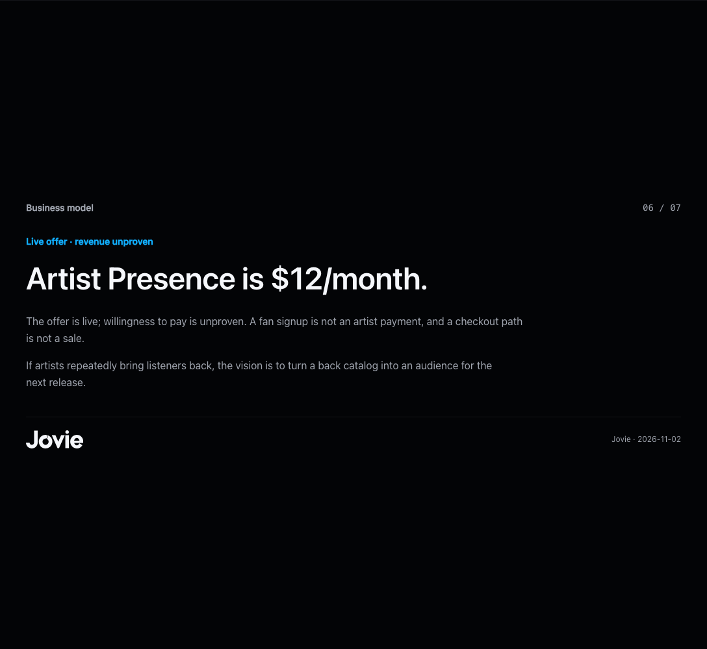
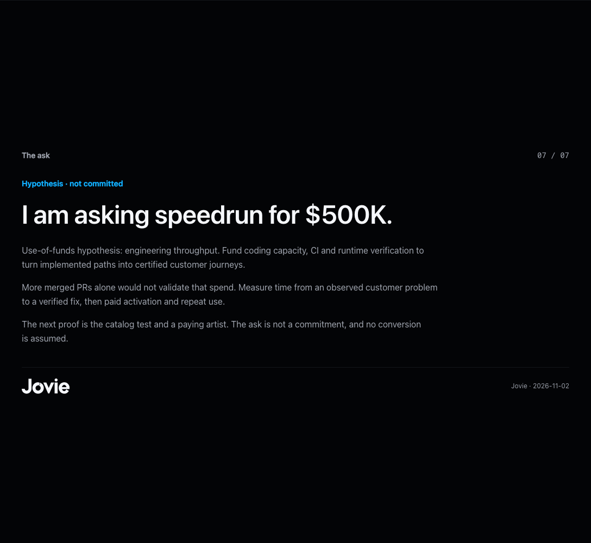

# Investor pitch refresh, November 2, 2026

Mission: let a speedrun investor distinguish implemented product from demonstrated customer value, then assess the next test and the ask.
Audience: speedrun investors. This is the existing gated investor brief at `/investor-portal`. The retired `/pitch` route returns a private 404 and remains unchanged.

## Audit of every original slide

Audit base: `a7c3146f7aa`. The seven core slides lived in `apps/web/lib/investors/fundraising-registry.ts` and rendered through `InvestorBrief`. The old route is private; this change preserves its access gate.

| Original slide or surface | Before | After |
| --- | --- | --- |
| 1. Thesis | “The next bottleneck in music is not making a song; it is operating the release around it.” Broad ambition led the brief. | Built capabilities lead. Vision appears once, conditionally, after the offer. |
| 2. Problem | Artists must become a marketing department; repeated work and lost context stated broadly. | Tim's observed campaign pattern: “The spike should leave a list.” |
| 3. Wedge | Turn release context into an executable launch plan, without a measurable first test. | $0 revenue, zero paying customers; named catalog comparison, two held-out songs, 50 captured fans and 30% email click-through bar. Pending and blocked on email. |
| 4. Product | One “operating surface”; a demonstration was the main evidence. | Catalog import, profiles, release pages, chat, merch to checkout. Every capability visibly says “BUILT, NOT CERTIFIED.” Nothing certified; release email blocked; reactivation agent not built. |
| 5. Loop | A proposed product learning loop spanning LIVE, DEMO, MANUAL and PLANNED. | “How Jovie ships”: one auto-scaling agent, Summer; issues, workers, PRs, CI, merge queue and production taste feedback. 6,818 PRs in the 90 days through November 2, explicitly engineering output. Boardy's year-of-feedback cost line. |
| 6. Founder | Generic artist founder who needed an “operating system.” | First-person solo founder and first customer; 15 years as an artist, Big Management, the unnamed 2016 New Jersey campaign, and the separate Apify business. No Jovie revenue implied. |
| 7. Round | Unspecified round to prove a paid creator workflow. | Ask speedrun for $500K. Engineering throughput explicitly a use-of-funds hypothesis; measure verified fixes and paid activation, not PR count alone. |
| Pricing objection | Pricing and packaging described as validation questions without naming the current offer. | Artist Presence at $12/month, derived from `ARTIST_VISIBILITY_OFFER`, with willingness to pay unproven. |
| Old $299/$199 prices | Neither appears in the audited seven-slide web registry at this base. They are stale values identified in the supplied historical materials. | Neither appears in the rendered deck. Regression checks prevent their return. |
| “100M Suno” | Absent from the current seven-slide registry. Not a defensible market-size input. | Omitted. The user-supplied approximately 2M paid base is also not presented as Jovie's market size. |
| X% / Z% / unsourced metrics | X% and Z% absent in this base. Current copy suppressed metrics broadly instead of showing the known baseline. | No placeholders; dated, sourced PR count and founder-attested $0. The 50/30% figures are test criteria, not results. No median-merge, revert-rate or market arithmetic. |
| Multiple agents | Current web slides did not enumerate agents; supplied historical deck claims list five lanes. | One agent, Summer, scales its coding workers. |
| Hero, video, PDF, appendix | July 11 date; vague readiness labels; linked legacy video/PDF; founder letter contained an em dash. | November 2 date, explicit on-slide statuses, no stale asset links, updated questions and founder letter, no em dashes in rendered copy. |

## Evidence and boundaries

The user-supplied `built-inventory.md`, `team-final.txt`, `context.md`, `memo-sources.md`, and `traction-1000.txt` ground the rewrite. The requested `speedrun-astra/claims.md` was absent; the supplied sibling `speedrun-astra/deck/claims.md` was found and reviewed. Its older design-sample “Live today” labels and lane count do not override the latest built inventory or the one-agent instruction. Registry provenance URNs identify these source artifacts; local absolute paths are retained in the requested private report.

The 6,818 figure is a historical count from unique PR numbers in first-parent merge subjects over the 90-day window through November 2. It is not deployment count, shipped customer outcomes, or certification. No new product flow was exercised or certified by this copy change. The legacy PDF endpoint remains gated and unchanged; the brief no longer links that unrefreshed asset.

No open investor-portal PR was found. PR #24132 owns investor-deck tooling and `yc-deck.ts`; this change leaves that implementation untouched, updates its existing test expectations for the canonical content, and notified Summer through the mesh (receipt `mesh-7e97404e-9516-4481-80de-ed9a23ccf69a`).

## Validation and output review

- `pnpm turbo typecheck`: 21/21 tasks passed.
- Source-reading gate: 167 tests passed.
- `pnpm --filter @jovie/web run lint`: passed, 11 existing warnings.
- Focused Vitest run: 17 tests passed. The additional source-reading gate exposed stale assertions for three disclosures and two meeting links; updated to the two current disclosures and one email link while preserving the 44px target checks. V8 coverage: InvestorBrief 100% lines / 85.71% branches; fundraising registry 86.15% lines / 79.54% branches.
- Playwright against the existing Storybook story, using the actual component and app tokens: seven desktop slides; no browser errors; no horizontal overflow at 1440x1000 or 390x844; all eight logos measured 28px.
- Visual iteration: added inner slide padding after the first render; recaptured each slide without sticky navigation in the crop. Mobile captures include product, test and ask. The capture harness releases Storybook’s hidden-overflow body wrapper so tall slides are not clipped.
- Claims/voice review: every implementation has a status; funding and test criteria are labelled; separate Apify sales from Jovie revenue; no candidate named; no market-size shortcut or compounded conversion claim.
- `jovie output check ... --kind pitch --mission ... --preset tim --fix auto`: unavailable, `MODULE_NOT_FOUND` for `scripts/output-quality/output-check.mjs`. No automated output-quality pass is claimed.

Output review receipt: mission and audience stated; DS/brand checked in real renders; claims, slop and harm checked against the supplied sources; revised after image review. Automated audience-intent judge unavailable in this checkout.

## Rendered slides

These are local source-backed Storybook captures, not production certification. Sticky site navigation is hidden only for individual slide crops.

Mobile: [Product](mobile-product.png), [Test](mobile-wedge.png), [Ask](mobile-round.png).
